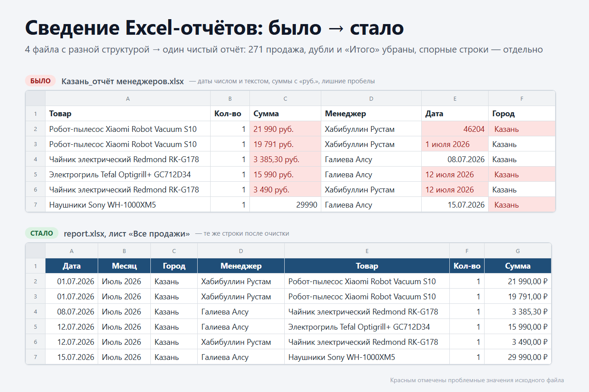
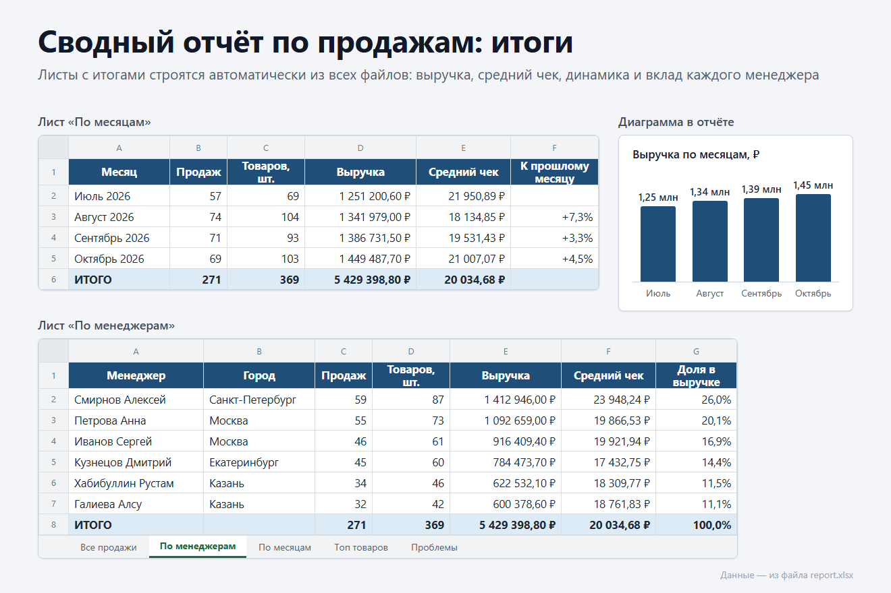

# Сводный отчёт по продажам из нескольких Excel-файлов

## Как выглядит результат





## Что это и зачем

Каждый месяц менеджеры или филиалы присылают свои таблицы продаж: у одного
дата написана `05.08.2026`, у другого `2026-08-05`, у третьего «5 августа»;
суммы то числом, то текстом `12 500,00 руб.`; где-то лишние пробелы в фамилиях,
повторы строк, строка «Итого» внизу. Свести это руками — полдня работы и риск ошибиться.

Скрипт делает это за секунды:

1. Берёт **все файлы `.xlsx` из папки `input`** (все листы в каждом файле).
2. Сам находит таблицу, даже если шапка не в первой строке, колонки стоят
   в другом порядке или называются по-разному («Менеджер» / «Сотрудник»,
   «Товар» / «Наименование», «Сумма» / «Сумма, руб.»).
3. **Чистит данные**: убирает лишние пробелы, приводит даты и суммы к нормальному
   виду, объединяет разные написания одного менеджера или товара
   («иванов сергей» и «Иванов  Сергей» — один человек), убирает дубли
   и строки «Итого».
4. Сохраняет готовый **`report.xlsx`**.

Ничего не теряется молча: всё, что не удалось разобрать, попадает на отдельный
лист «Проблемы» с указанием файла, строки и причины.

## Что в отчёте

| Лист | Что показывает |
|---|---|
| **Все продажи** | Единая чистая таблица: дата, месяц, город, менеджер, товар, количество, сумма и откуда взята строка (файл / лист / номер строки). Включён фильтр, шапка закреплена. |
| **По менеджерам** | Выручка, число продаж, проданные штуки, средний чек и доля каждого менеджера. Строка ИТОГО. |
| **По месяцам** | Выручка по месяцам, средний чек, рост к прошлому месяцу + столбчатая диаграмма. |
| **Топ товаров** | Рейтинг товаров по выручке: штуки, средняя цена, доля. Тройка лидеров выделена. |
| **Проблемы** | Строки, которые не попали в отчёт, и почему: непонятная дата, сумма «уточнить», пустой товар, отрицательная сумма, дубль, строка «Итого». |

Суммы — в рублях (`12 500,00 ₽`), цветовая шкала и полосы подсвечивают
крупные и мелкие значения. Отчёт готов к печати (альбомная ориентация, по ширине листа).

В папке уже лежат пример входных файлов (`input/`) и пример готового отчёта (`report.xlsx`).

## Как запустить на Windows (по шагам)

**Шаг 1. Установите Python** (один раз).
Скачайте с [python.org/downloads](https://www.python.org/downloads/) и при установке
**поставьте галочку «Add python.exe to PATH»**.

**Шаг 2. Установите библиотеку для работы с Excel** (один раз).
Откройте папку проекта, в адресной строке Проводника напишите `cmd` и нажмите Enter.
В открывшемся чёрном окне выполните:

```
python -m pip install -r requirements.txt
```

**Шаг 3. Положите свои файлы** `.xlsx` в папку `input` (старые примеры оттуда удалите).

**Шаг 4. Запустите отчёт.** Дважды щёлкните `run_report.bat` — или в том же окне `cmd`:

```
python build_report.py
```

Через пару секунд рядом появится `report.xlsx`, а в окне — краткая сводка:

```
Файлов: 4, листов с данными: 5, строк прочитано: 285 (пустых пропущено: 4)
В отчёт попало продаж: 271 на сумму 5 429 398,80 руб.
Убрано дублей: 4. Всего строк на листе «Проблемы»: 14
```

> Если пишет «файл открыт в Excel» — закройте старый `report.xlsx` и запустите ещё раз.

### Свои папки

Можно указать, откуда брать файлы и куда сохранить отчёт:

```
python build_report.py --input "D:\Выгрузки\Октябрь" --output "D:\Отчёты\Октябрь.xlsx"
```

## Как подставить свои файлы

- Подходит любой `.xlsx`, в котором есть колонки **Дата, Менеджер, Товар, Сумма**.
  Колонки **Количество** и **Город/Филиал** — по желанию (если количества нет,
  считается 1 шт.; если нет города — «Не указан»).
- Шапка может быть в любой из первых 15 строк, над ней может быть заголовок.
- Порядок колонок и лишние колонки (№, комментарий, артикул) не мешают.
- Если в вашей выгрузке колонка называется по-своему (например, «Контрагент-менеджер»),
  откройте `build_report.py` в Блокноте, найдите в начале `COLUMN_ALIASES`
  и допишите название в нужный список.
- Старый формат `.xls` не читается — откройте его в Excel и
  «Сохранить как» → «Книга Excel (.xlsx)».

### Какие «грязные» данные понимает

| Что | Примеры |
|---|---|
| Даты | настоящая дата Excel, `05.08.2026`, `05.08.26`, `2026-08-05`, `05/08/2026`, `5 августа 2026`, `05.08.2026 14:35`, дата «числом» (`46239`) |
| Суммы | число, `12 500,50`, `12500.50`, `12 500 руб.`, `7 990,00 ₽`, `1.250,50`, неразрывные пробелы |
| Количество | `2`, `2 шт.` |
| Текст | лишние и двойные пробелы, разный регистр ФИО |

Дублем считается строка, у которой совпадают **дата, менеджер, город, товар,
количество и сумма**. Повтор попадает в «Проблемы» со ссылкой на первую такую строку —
если это была настоящая повторная продажа, её легко найти и вернуть.

## Демо-данные

`make_sample_data.py` создаёт в `input/` четыре файла «от филиалов»
(Москва, Санкт-Петербург, Казань, Екатеринбург) за июль–октябрь 2026
с намеренно внесёнными ошибками и печатает контрольные цифры — с ними
можно сверить отчёт:

```
python make_sample_data.py
python build_report.py
```

## Файлы проекта

```
build_report.py       — основной скрипт: читает input/, строит report.xlsx
make_sample_data.py   — генератор тестовых файлов
run_report.bat        — запуск двойным щелчком
requirements.txt      — нужна только библиотека openpyxl
input/                — сюда класть выгрузки (сейчас — демо-файлы)
report.xlsx           — пример готового отчёта
```

Нужен только Python 3.10+ и openpyxl — без pandas и других тяжёлых библиотек.
